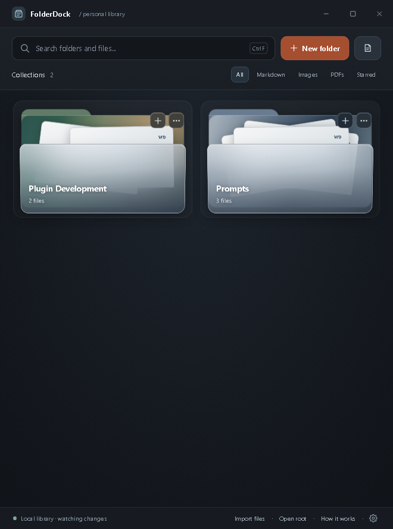
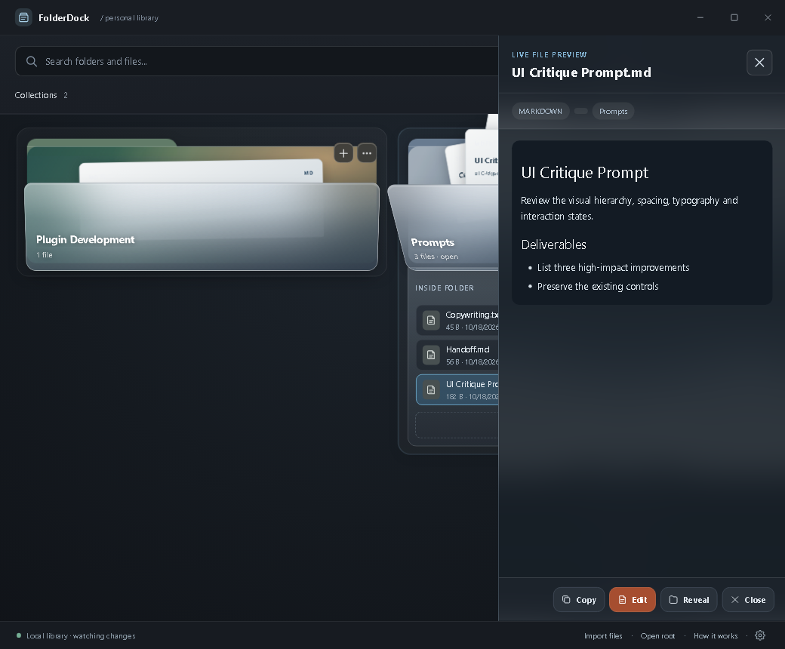

# FolderDock

[](https://github.com/stoehner/FolderDock/actions/workflows/ci.yml)
[](https://github.com/stoehner/FolderDock/releases)
[](LICENSE)

A local-first Windows file shelf. Animated glass folders that hold real files on disk, with native drag and drop between your library and any other program.

FolderDock is designed to sit beside your editor, browser, or notes app as a compact vertical shelf for prompts, reference documents, screenshots, and everyday project assets. There is no login, no cloud sync, and no background service. Everything the app shows is a real file in a folder you control.

<p align="center">
  
  
</p>

## Contents

- [About](#about)
- [Features](#features)
- [Installation](#installation)
- [Where your files live](#where-your-files-live)
- [Keyboard shortcuts](#keyboard-shortcuts)
- [Development](#development)
- [Testing](#testing)
- [Security](#security)
- [Documentation](#documentation)
- [Contributing](#contributing)
- [License](#license)

## About

FolderDock presents your files as animated glass folder cards, two per row, in a narrow resizable window. Click a frosted folder front and it opens in place to reveal its contents. Each folder shows up to three paper sheets representing its newest files, and every sheet is a real file record: its name, type tag, and summary come from the file on disk, and grabbing it starts a native Windows drag with the actual file attached.

The project started as an interactive HTML concept (preserved in [docs/reference](docs/reference)) and was rebuilt as a production desktop application with genuine operating system integration. The renderer cannot touch the filesystem directly. All file operations go through a typed, allowlisted IPC bridge to the Electron main process, which validates that every path stays inside the library root.

## Features

**Collections**

- Glass folder cards with eighteen color styles in three sections plus a visual custom color picker with a saved, deletable palette, reorderable by drag handle, renamable and recolorable from the right-click menu
- Open a folder in place with an internal, scrollable file list
- Files created, renamed, moved, or deleted through real filesystem operations, with destructive actions going to the Windows Recycle Bin. Imports are deduped: a file that is byte-identical to one already in the target collection is skipped with a toast instead of creating a ` (2)` copy
- Move a file out of the library from its right-click menu into any folder you choose (same-drive rename; cross-drive copy plus Recycle Bin for the library copy)
- Loose files at the library root surface in a built-in Unsorted collection so nothing is ever hidden

**Native drag and drop**

- Drag a paper sheet or file row straight into Explorer, an editor, an email, or any app that accepts files. The original always stays in your library
- Drop files from Explorer onto a collection or the toolbar drop zone to move them into your library, with automatic collision suffixes for duplicate names; the source copy is removed so there is nothing to clean up afterwards
- Drop a library file onto another collection to move it, or drop it anywhere else to leave it untouched

**Preview and editing**

- Hover summaries after 250 ms: real content excerpts for text and Markdown, dimensions and size for images and PDFs
- Click for a preview modal: sanitized Markdown rendering, plain text, actual images, and PDF pages via a sandboxed pdf.js renderer
- Double-click to edit in the built-in editor with atomic writes, BOM preservation, and conflict detection when the file changed on disk

**Everything else**

- Search and category filters (All, Markdown, Images, PDFs, Favorites) with one-click star buttons on files and collections, manual timestamped library backups to a folder you choose, light and dark themes
- Filesystem watching keeps the shelf in sync when files change outside the app
- Configurable library root in Settings, with one-click reveal in File Explorer

## Installation

Download the latest build from the [releases page](https://github.com/stoehner/FolderDock/releases):

- **FolderDock Setup**: per-user NSIS installer with Start menu and desktop shortcuts. You can choose the install directory
- **FolderDock Portable**: single-file portable build, no installation required

Windows may show a SmartScreen warning because the binaries are not code signed. Choose "More info" and then "Run anyway". FolderDock requires Windows 10 or 11.

On first launch the app creates a `Documents\FolderDock` library with a welcome note. Delete that folder or pick your own root in Settings at any time.

## Where your files live

The library root is a normal Windows folder, `Documents\FolderDock` by default. Treat it like any other folder: back it up, sync it, or point the app at a different location in Settings.

FolderDock stores UI preferences only (theme, folder order and colors, stars, window geometry, last open collection) in `%APPDATA%\FolderDock\ui-prefs.json`. File contents are never stored anywhere but on disk in the library.

## Keyboard shortcuts

| Shortcut | Action |
|---|---|
| `Ctrl F` | Focus search |
| `Ctrl N` | New note in the open collection |
| `Ctrl S` | Save in the editor |
| `Enter` / `Space` | Preview the focused sheet or file row |
| `F2` | Rename the focused file |
| `Delete` | Delete the focused file (with confirmation) |
| `Escape` | Close the topmost surface, preview, or folder |
| Double-click | Edit a text or Markdown file |

## Development

Requirements: Node.js 20.19 or later (tested on 22) and npm 10 or later. All dependencies install project-locally; no global tooling is required.

```bash
git clone https://github.com/stoehner/FolderDock.git
cd FolderDock
npm install
npm run dev
```

Useful scripts:

| Command | Purpose |
|---|---|
| `npm run dev` | Launch with hot reload |
| `npm run icons` | Regenerate the app icon and native drag icons |
| `npm run typecheck` | TypeScript for main, preload, and renderer |
| `npm run lint` | ESLint across the project |
| `npm run test` | Unit tests with Vitest |
| `npm run test:e2e` | Build, then run Playwright Electron end-to-end tests |
| `npm run dist` | Build the NSIS installer and portable exe into `dist/` |

Environment overrides for development and testing:

| Variable | Effect |
|---|---|
| `FOLDERDOCK_ROOT` | Force a specific library root |
| `FOLDERDOCK_USER_DATA` | Redirect preferences storage |
| `FOLDERDOCK_DEVTOOLS=1` | Open DevTools on launch |
| `FOLDERDOCK_SOFTWARE_GPU=1` | Disable GPU acceleration (used by CI) |

## Testing

- **Unit tests** (Vitest, 60 tests): path and name validation including Windows reserved names and traversal attempts, collision naming, excerpt extraction, preferences merging, binary sniffing, image header parsing for PNG, JPEG, GIF, BMP, WebP, and SVG, and color conversions for the picker
- **End-to-end tests** (Playwright Electron, 46 journeys): boot and first-run seeding, collection creation, note editing saved to disk, rename, move, delete to Recycle Bin, search, hover summaries, preview modal, Unsorted detection, external change watching, theme persistence, custom colors, the saved color palette, restore defaults, favorites starring and filtering, drop zone behavior, external import moves, duplicate-import skipping, moving a file out of the library to a chosen destination, manual backups, and right-click menus
- **Manual checklist**: native drag interactions cannot be automated. Work through [docs/native-drag-test-checklist.md](docs/native-drag-test-checklist.md) on a real Windows desktop before shipping

## Security

- The renderer runs with `contextIsolation: true`, `sandbox: true`, `nodeIntegration: false`, and a strict Content Security Policy
- A minimal, allowlisted, typed IPC bridge is the only path to the main process
- Every filesystem operation validates that the resolved path stays inside the library root
- Markdown is rendered through marked and DOMPurify with a strict allow-list; SVGs display as images so embedded scripts never execute; PDFs render through pdf.js without plugins; imported files are never executed
- The `fdfile://` media protocol serves only paths inside the library root
- External http and https links open in the default browser; in-app navigation is blocked

## Documentation

- [Implementation report](docs/implementation-report.md): architecture, decisions, deviations, and known limitations
- [Native drag test checklist](docs/native-drag-test-checklist.md): manual Windows verification steps
- [Reference material](docs/reference): the original interactive HTML concept and the build handoff it was derived from

## Contributing

Issues and pull requests are welcome. For feature proposals, please open an issue first to discuss the approach. Keep changes consistent with the local-first, no-network principles of the project: no telemetry, no cloud services, and no renderer access to raw filesystem APIs.

## License

This project is licensed under the [MIT License](LICENSE).
